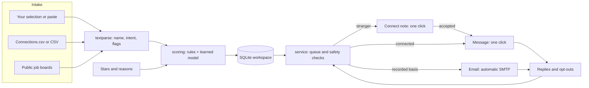
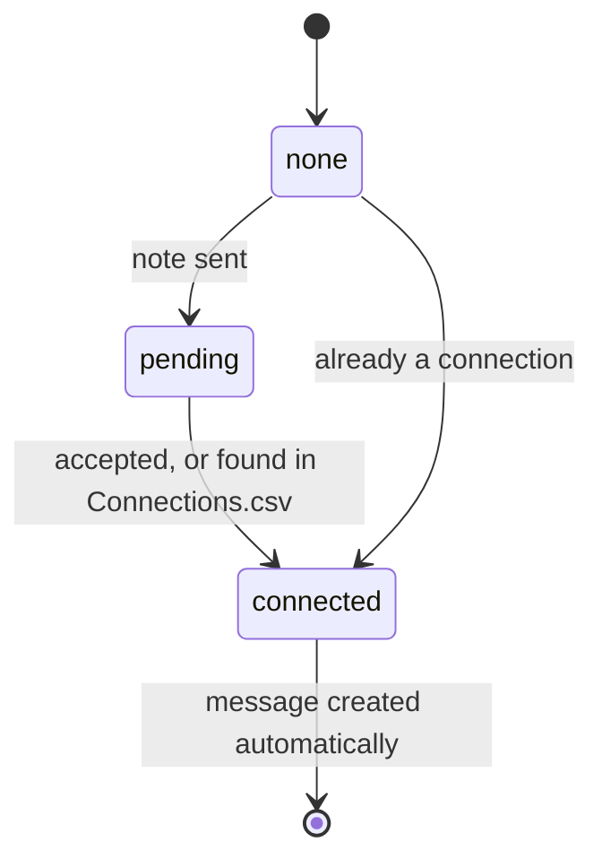

# Architecture

## Choices

| Decision | Why |
|---|---|
| Python standard library only | Free to run, nothing to break, quick to install anywhere |
| SQLite file per workspace | Local data, simple client isolation, easy backup and deletion |
| Rules and a small logistic model, no LLM | No token cost, works offline, every score is explainable |
| Rules first, model blended in | Useful on day one. The model has no influence until it has at least 6 ratings with both likes and dislikes, then rises to a maximum of 85% |
| Safety checks in `service` and `channels`, not templates | A stale queue or a careless template cannot reach someone who opted out |
| Plain DOM building with `textContent` | Imported contact data cannot inject script into the dashboard |

## Modules

| File | Responsibility |
|---|---|
| `textparse.py` | Names, URLs, identity keys, intent and flag detection, pasted-text parsing |
| `scoring.py` | Rule score, features, training, prediction, explanations |
| `messages.py` | Rendering, template lint, Thompson-sampling variant choice |
| `service.py` | Campaigns, items, learning loop, queue, connect-first state, suppression, insights |
| `channels.py` | Automatic email with a final check at send time |
| `sources.py` | Public job-board adapters with an allow-listed host set |
| `importers.py` | LinkedIn export and generic CSV, safe CSV export |
| `plans.py` | Tiers and Ed25519 license keys |
| `server.py`, `static/` | Local API and dashboard |

## Connect-first state machine

## Learning

Stars become a soft target from 0 to 1. Features are prefixed by field (`t:` title, `b:` body, `c:` company, `l:` location, `i:` intent, `f:` flag). A rating's reason multiplies the update on the blamed fields by 3 and on the others by 0.2, so a job rejected for its location does not teach the model to dislike the job's skills.

## Local security

- Binds to `127.0.0.1` and rejects other `Host` headers, which stops DNS rebinding.
- Writes require a custom header and a same-origin `Origin`, which stops cross-site requests.
- A strict Content Security Policy forbids inline script.
- Links must be `http` or `https`, and CSV export neutralises spreadsheet formulas.
- Job sources use fixed hosts and validated slugs, so a setting cannot trigger a request to an arbitrary URL.
- Contact data is never written to server logs.

## Evidence

See `tests/test_learning.py`. Two groups of jobs look identical to the keyword rules, and only the user's hidden preference separates them. 10% of ratings are deliberately wrong.

| Ratings given | Held-out precision@10 |
|---|---|
| 0 | 0.50 |
| 5 (model not active yet) | 0.50 |
| 10 | 1.00 |
| 20 | 1.00 |
| 40 | 1.00 |

This data is synthetic and cleanly separated, so it shows the mechanism works. It does not predict results on real preferences, which Stage 1 of the [roadmap](ROADMAP.md) measures.
